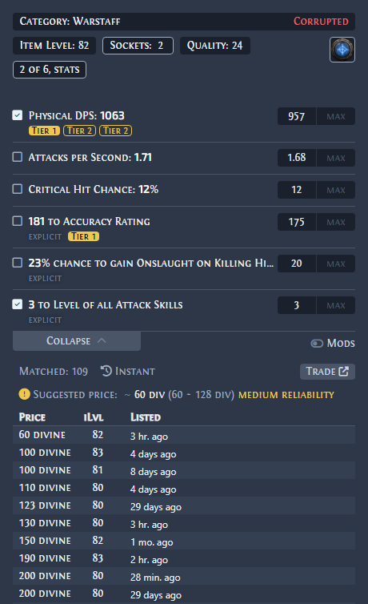
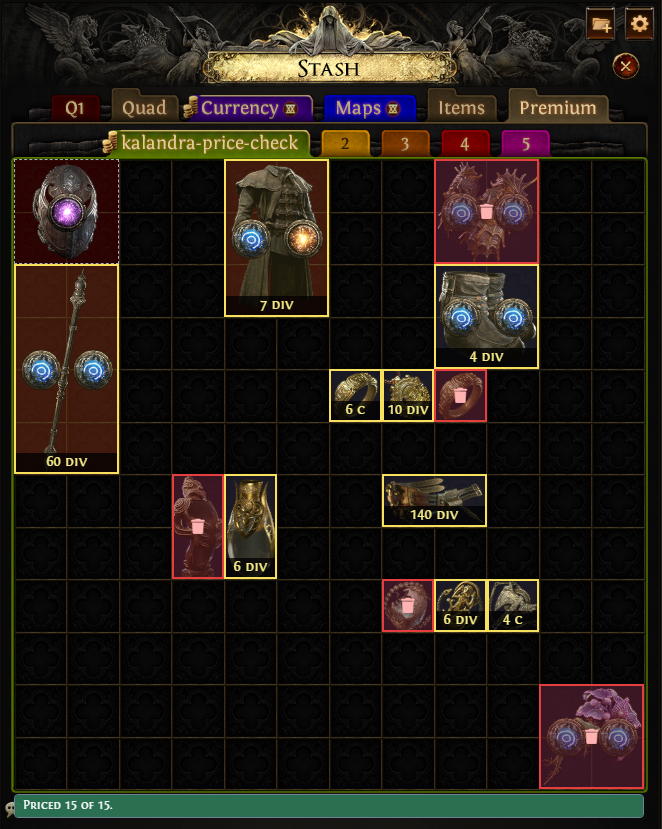

#  Kalandra

A Path of Exile 2 overlay for price checking items, with widgets for maps, stash search, XP tracking and more.

Kalandra continues [Exiled Exchange 2](https://github.com/Kvan7/Exiled-Exchange-2) by Kvan7, which is a fork of
[Awakened PoE Trade](https://github.com/SnosMe/awakened-poe-trade) by SnosMe.

The only official download sites are <https://davidcristian.github.io/Kalandra/download> and
<https://github.com/davidcristian/Kalandra/releases>. Any other location is not official and may be malicious.

## Highlights

### Suggested price

A price check suggests a price for any item, rares included. Kalandra works out one price, a range and how reliable
they are from the listings the search already got, leaves out likely price fixing, and for a rare turns on the stats
that set its price, so the search finds items that sell for the same reasons as yours. It is on by default:
[how it works](https://davidcristian.github.io/Kalandra/suggested-price).

### Stash prices

Put your loot into one public stash tab and go back to mapping. Kalandra reads the tab from the trade site in the
background, prices every item in it with the suggested price, within a trade search budget you set, and when you open
the tab in the game it marks each item over the stash with its price, or as trash. Turn it on under the suggested
price setting: [how to set it up](https://davidcristian.github.io/Kalandra/stash-prices).

## Moving from Exiled Exchange 2 or Awakened PoE Trade

Kalandra installs beside both and keeps its settings in its own folder. The
[download page](https://davidcristian.github.io/Kalandra/download) has the steps to copy your settings over.

## FAQ

<https://davidcristian.github.io/Kalandra/faq>

## Tool showcase

| Gem                                                | Rare                                                 | Unique                                                   | Currency                                                     |
| -------------------------------------------------- | ---------------------------------------------------- | -------------------------------------------------------- | ------------------------------------------------------------ |
|  |  |  |  |

### Development

See [DEVELOPING.md](./DEVELOPING.md) to run and build the app, and [docs/dev/](./docs/dev/index.md) for the
architecture, the decisions and the module docs. The rules every change follows are in [AGENTS.md](./AGENTS.md).

### Acknowledgments

- [Exiled Exchange 2](https://github.com/Kvan7/Exiled-Exchange-2)
- [awakened-poe-trade](https://github.com/SnosMe/awakened-poe-trade)
- [libuiohook](https://github.com/kwhat/libuiohook)
- [poe.ninja](https://poe.ninja/)

## License

Kalandra is licensed under the [GNU Affero General Public License v3.0](LICENSE). It contains code from Awakened
PoE Trade and Exiled Exchange 2 under the [MIT License](LICENSES/MIT.txt).
